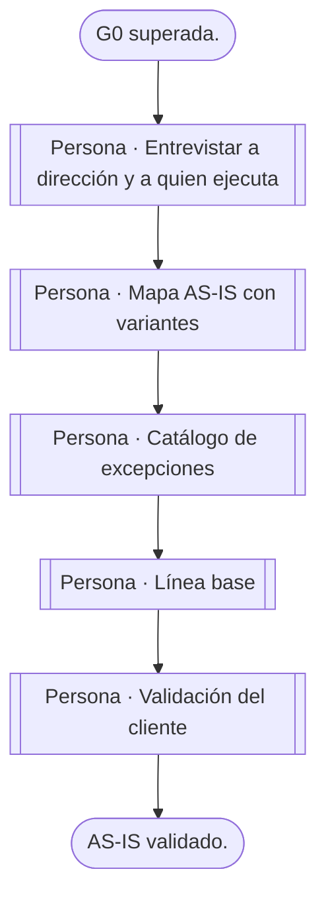

<!-- Generado por tools/org_gen.py desde tools/org_data/. No editar a mano. -->
# P32 · Descubrimiento de procesos

**Origen:** Atlas Evolución v1.1 §10 (propuesta) · **Cuándo implantar:** MVP · **Estado de la ficha:** draft · **Implementado:** No

Leyenda: rectángulo, regla en código · paralelogramo, la IA propone · doble barra, persona · redondeado, sistema.

## 1. Descripción y objetivo
Entrevistas, evidencia, AS-IS, variantes, excepciones y línea base.

## 2. Evento de inicio
G0 superada.

## 3. Condiciones y datos de entrada
Entrevistas, procedimientos, registros autorizados.

## 4. Actividades y tareas
1. Entrevistar a dirección y a quien ejecuta (Persona)
2. Mapa AS-IS con variantes (Persona)
3. Catálogo de excepciones (Persona)
4. Línea base (Persona)
5. Validación del cliente (Persona)

## 5. Responsables
Arquitecto de procesos

## 6. Departamentos y especialistas
- [Arquitecto de procesos](../../knowledge/procesos/arquitecto-procesos.md)
- [Coordinación sectorial y seguros](../../knowledge/sectores/especialista-sectorial.md)
- [Especialista en métricas](../../knowledge/procesos/metricas.md)

## 7. Decisiones y reglas
- Minimización de datos y mandato del cliente.

## 8. Estados y transiciones
Despliegue: discovery

## 9. Entradas y salidas de cada tarea
| Tarea | Tipo | Salida |
|---|---|---|
| Entrevistar a dirección y a quien ejecuta | Persona | Actas |
| Mapa AS-IS con variantes | Persona | AS-IS |
| Catálogo de excepciones | Persona | Excepciones |
| Línea base | Persona | Baseline |
| Validación del cliente | Persona | G1 |

## 10. Sistemas y conectores
Motor de procesos y PostgreSQL (por defecto).

## 11. Permisos y controles
Mínimos para la tarea; cliente derivado de la identidad.

## 12. Excepciones y rutas alternativas
Errores según P22; incidentes según P28.

## 13. Aprobaciones humanas
- El cliente valida el AS-IS (G1)

## 14. Timeouts y reintentos
Timeout por tarea; máximo 3 intentos con espera exponencial y aleatoria solo para errores transitorios ([P22](P22-gestion-de-errores-y-reintentos.md))

## 15. Criterio de finalización
AS-IS validado.

## 16. Evidencias que se conservan
- Actas, mapa, baseline

## 17. KPI
- Variantes descubiertas

## 18. Dependencias
- [P31](P31-calificacion-de-oportunidad.md)
- [P33](P33-diseno-y-validacion-to-be.md)
- [P37](P37-medicion-de-rendimiento-y-valor.md)

## 19. Precedentes y plantillas
- processes/templates/proceso-cliente.md

## 20. Pruebas necesarias
- Muestreo de casos reales contra el mapa.

---
Especialistas: Arquitecto de procesos, Coordinación sectorial y seguros, Especialista en métricas. Definición original: Atlas Evolución v1.1 §10 (propuesta).
