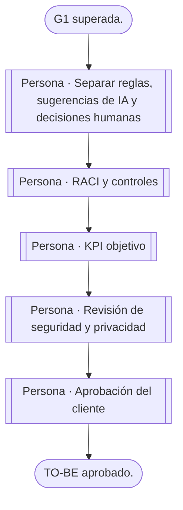

<!-- Generado por tools/org_gen.py desde tools/org_data/. No editar a mano. -->
# P33 · Diseño y validación TO-BE

**Origen:** Atlas Evolución v1.1 §10 (propuesta) · **Cuándo implantar:** MVP · **Estado de la ficha:** draft · **Implementado:** No

Leyenda: rectángulo, regla en código · paralelogramo, la IA propone · doble barra, persona · redondeado, sistema.

## 1. Descripción y objetivo
Modelo futuro, reglas, controles, RACI, KPI y aprobación del cliente.

## 2. Evento de inicio
G1 superada.

## 3. Condiciones y datos de entrada
AS-IS validado.

## 4. Actividades y tareas
1. Separar reglas, sugerencias de IA y decisiones humanas (Persona)
2. RACI y controles (Persona)
3. KPI objetivo (Persona)
4. Revisión de seguridad y privacidad (Persona)
5. Aprobación del cliente (Persona)

## 5. Responsables
Arquitecto de procesos

## 6. Departamentos y especialistas
- [Arquitecto de procesos](../../knowledge/procesos/arquitecto-procesos.md)
- [Especialista en ciberseguridad](../../knowledge/seguridad-legal/ciberseguridad.md)
- [Especialista legal y privacidad](../../knowledge/seguridad-legal/legal-privacidad.md)
- [Especialista en métricas](../../knowledge/procesos/metricas.md)

## 7. Decisiones y reglas
—

## 8. Estados y transiciones
Despliegue: design

## 9. Entradas y salidas de cada tarea
| Tarea | Tipo | Salida |
|---|---|---|
| Separar reglas, sugerencias de IA y decisiones humanas | Persona | TO-BE |
| RACI y controles | Persona | RACI |
| KPI objetivo | Persona | KPI |
| Revisión de seguridad y privacidad | Persona | Informe |
| Aprobación del cliente | Persona | G2 |

## 10. Sistemas y conectores
Motor de procesos y PostgreSQL (por defecto).

## 11. Permisos y controles
Mínimos para la tarea; cliente derivado de la identidad.

## 12. Excepciones y rutas alternativas
Errores según P22; incidentes según P28.

## 13. Aprobaciones humanas
- Cliente (G2)

## 14. Timeouts y reintentos
Timeout por tarea; máximo 3 intentos con espera exponencial y aleatoria solo para errores transitorios ([P22](P22-gestion-de-errores-y-reintentos.md))

## 15. Criterio de finalización
TO-BE aprobado.

## 16. Evidencias que se conservan
- TO-BE versionado

## 17. KPI
- Cambios tras aprobación

## 18. Dependencias
- [P32](P32-descubrimiento-de-procesos.md)
- [P34](P34-gestion-de-definiciones-de-proceso.md)

## 19. Precedentes y plantillas
Ninguna todavía.

## 20. Pruebas necesarias
- Cada regla del TO-BE tiene dueño y prueba.

---
Especialistas: Arquitecto de procesos, Especialista en ciberseguridad, Especialista legal y privacidad, Especialista en métricas. Definición original: Atlas Evolución v1.1 §10 (propuesta).
