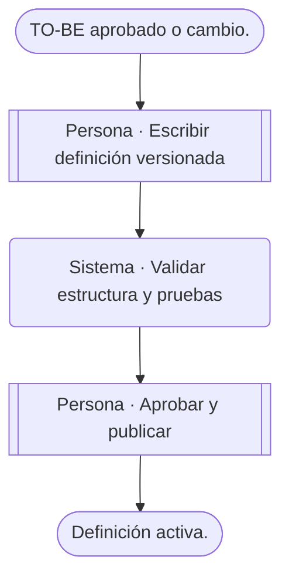

<!-- Generado por tools/org_gen.py desde tools/org_data/. No editar a mano. -->
# P34 · Gestión de definiciones de proceso

**Origen:** Atlas Evolución v1.1 §10 (propuesta) · **Cuándo implantar:** MVP · **Estado de la ficha:** draft · **Implementado:** Sí: validación en src/varios/procesos/definiciones.py

Leyenda: rectángulo, regla en código · paralelogramo, la IA propone · doble barra, persona · redondeado, sistema.

## 1. Descripción y objetivo
Versiones, dueño, estados, pruebas, aprobación, publicación y retirada.

## 2. Evento de inicio
TO-BE aprobado o cambio.

## 3. Condiciones y datos de entrada
Definición.

## 4. Actividades y tareas
1. Escribir definición versionada (Persona)
2. Validar estructura y pruebas (Sistema)
3. Aprobar y publicar (Persona)

## 5. Responsables
Arquitecto de procesos

## 6. Departamentos y especialistas
- [Arquitecto de procesos](../../knowledge/procesos/arquitecto-procesos.md)
- [Especialista backend](../../knowledge/ingenieria/backend.md)

## 7. Decisiones y reglas
- Las definiciones aprobadas son inmutables; un cambio crea versión nueva.

## 8. Estados y transiciones
Definición: draft → under_review → approved → active → deprecated → retired

## 9. Entradas y salidas de cada tarea
| Tarea | Tipo | Salida |
|---|---|---|
| Escribir definición versionada | Persona | JSON de definición |
| Validar estructura y pruebas | Sistema | Validación |
| Aprobar y publicar | Persona | active |

## 10. Sistemas y conectores
Motor de procesos y PostgreSQL (por defecto).

## 11. Permisos y controles
Mínimos para la tarea; cliente derivado de la identidad.

## 12. Excepciones y rutas alternativas
Errores según P22; incidentes según P28.

## 13. Aprobaciones humanas
- Socios

## 14. Timeouts y reintentos
Timeout por tarea; máximo 3 intentos con espera exponencial y aleatoria solo para errores transitorios ([P22](P22-gestion-de-errores-y-reintentos.md))

## 15. Criterio de finalización
Definición activa.

## 16. Evidencias que se conservan
- processes/definitions/*.json

## 17. KPI
- Definiciones con pruebas

## 18. Dependencias
- [P12](P12-gestion-de-cambios.md)
- [P35](P35-gestion-de-instancias-y-excepciones.md)

## 19. Precedentes y plantillas
Ninguna todavía.

## 20. Pruebas necesarias
- tests/test_definiciones.py valida todas las definiciones.

---
Especialistas: Arquitecto de procesos, Especialista backend. Definición original: Atlas Evolución v1.1 §10 (propuesta).
