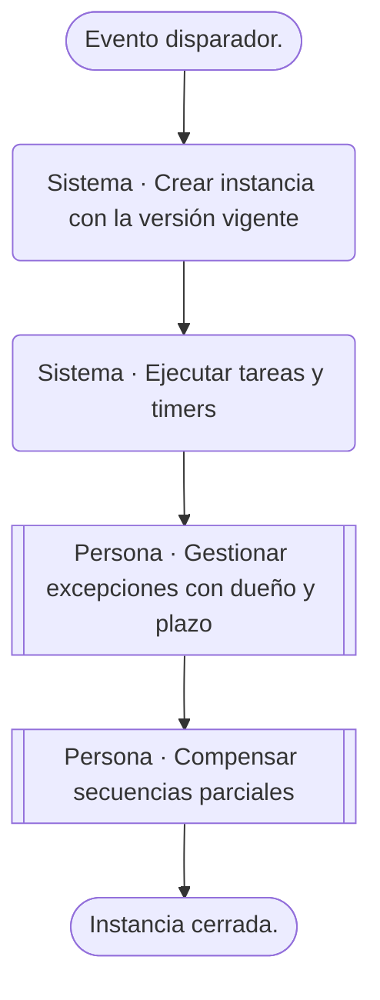

<!-- Generado por tools/org_gen.py desde tools/org_data/. No editar a mano. -->
# P35 · Gestión de instancias y excepciones

**Origen:** Atlas Evolución v1.1 §10 (propuesta) · **Cuándo implantar:** MVP · **Estado de la ficha:** draft · **Implementado:** No

Leyenda: rectángulo, regla en código · paralelogramo, la IA propone · doble barra, persona · redondeado, sistema.

## 1. Descripción y objetivo
Estados, tareas, SLA, timers, reintentos, escalado, compensación y cierre.

## 2. Evento de inicio
Evento disparador.

## 3. Condiciones y datos de entrada
Definición activa.

## 4. Actividades y tareas
1. Crear instancia con la versión vigente (Sistema)
2. Ejecutar tareas y timers (Sistema)
3. Gestionar excepciones con dueño y plazo (Persona)
4. Compensar secuencias parciales (Persona)

## 5. Responsables
Motor de procesos

## 6. Departamentos y especialistas
- [Especialista backend](../../knowledge/ingenieria/backend.md)
- [Especialista en automatización](../../knowledge/procesos/automatizacion.md)

## 7. Decisiones y reglas
- La instancia conserva su versión salvo migración auditada.
- El LLM no cambia estados.

## 8. Estados y transiciones
Instancia: created → ready → running → waiting_external / waiting_human → completed / failed / cancelled

## 9. Entradas y salidas de cada tarea
| Tarea | Tipo | Salida |
|---|---|---|
| Crear instancia con la versión vigente | Sistema | Instancia |
| Ejecutar tareas y timers | Sistema | Progreso |
| Gestionar excepciones con dueño y plazo | Persona | Excepción resuelta |
| Compensar secuencias parciales | Persona | Compensación registrada |

## 10. Sistemas y conectores
Motor de procesos y PostgreSQL (por defecto).

## 11. Permisos y controles
Mínimos para la tarea; cliente derivado de la identidad.

## 12. Excepciones y rutas alternativas
Errores según P22; incidentes según P28.

## 13. Aprobaciones humanas
Según la matriz de riesgo (docs/14).

## 14. Timeouts y reintentos
Timeout por tarea; máximo 3 intentos con espera exponencial y aleatoria solo para errores transitorios ([P22](P22-gestion-de-errores-y-reintentos.md))

## 15. Criterio de finalización
Instancia cerrada.

## 16. Evidencias que se conservan
- ProcessEvent por transición

## 17. KPI
- Excepciones por instancia

## 18. Dependencias
- [P22](P22-gestion-de-errores-y-reintentos.md)
- [P34](P34-gestion-de-definiciones-de-proceso.md)

## 19. Precedentes y plantillas
Ninguna todavía.

## 20. Pruebas necesarias
- Reinicio no pierde ni duplica tareas.

---
Especialistas: Especialista backend, Especialista en automatización. Definición original: Atlas Evolución v1.1 §10 (propuesta).
