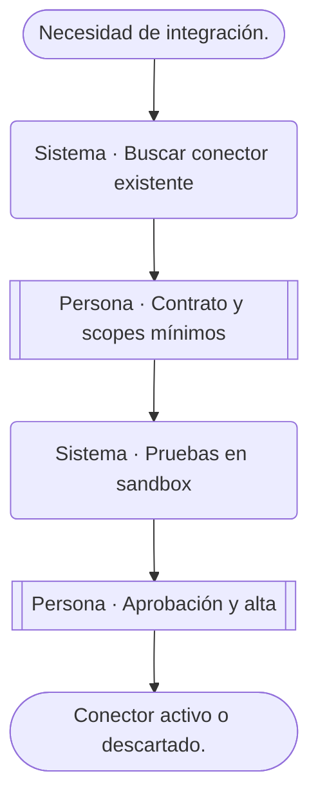

<!-- Generado por tools/org_gen.py desde tools/org_data/. No editar a mano. -->
# P36 · Gestión del catálogo de conectores

**Origen:** Atlas Evolución v1.1 §10 (propuesta) · **Cuándo implantar:** Antes de automatizar · **Estado de la ficha:** draft · **Implementado:** No

Leyenda: rectángulo, regla en código · paralelogramo, la IA propone · doble barra, persona · redondeado, sistema.

## 1. Descripción y objetivo
Alta, evaluación, scopes, versiones, pruebas, cambios y revocación.

## 2. Evento de inicio
Necesidad de integración.

## 3. Condiciones y datos de entrada
Sistema destino.

## 4. Actividades y tareas
1. Buscar conector existente (Sistema)
2. Contrato y scopes mínimos (Persona)
3. Pruebas en sandbox (Sistema)
4. Aprobación y alta (Persona)

## 5. Responsables
Integraciones

## 6. Departamentos y especialistas
- [Especialista en integraciones](../../knowledge/ingenieria/integraciones.md)
- [Especialista en ciberseguridad](../../knowledge/seguridad-legal/ciberseguridad.md)

## 7. Decisiones y reglas
- Credenciales por cliente y entorno.

## 8. Estados y transiciones
Conector: draft → tested → approved → active → degraded → suspended → retired

## 9. Entradas y salidas de cada tarea
| Tarea | Tipo | Salida |
|---|---|---|
| Buscar conector existente | Sistema | Reutilizable o no |
| Contrato y scopes mínimos | Persona | Contrato |
| Pruebas en sandbox | Sistema | Pruebas |
| Aprobación y alta | Persona | Conector activo |

## 10. Sistemas y conectores
Motor de procesos y PostgreSQL (por defecto).

## 11. Permisos y controles
Mínimos para la tarea; cliente derivado de la identidad.

## 12. Excepciones y rutas alternativas
Errores según P22; incidentes según P28.

## 13. Aprobaciones humanas
- Socios (L3 para operaciones externas)

## 14. Timeouts y reintentos
Timeout por tarea; máximo 3 intentos con espera exponencial y aleatoria solo para errores transitorios ([P22](P22-gestion-de-errores-y-reintentos.md))

## 15. Criterio de finalización
Conector activo o descartado.

## 16. Evidencias que se conservan
- integrations/catalog

## 17. KPI
- Conectores degradados

## 18. Dependencias
- [P21](P21-ejecucion-segura-de-herramientas.md)
- [P30](P30-gestion-de-identidades-y-secretos.md)

## 19. Precedentes y plantillas
Ninguna todavía.

## 20. Pruebas necesarias
- Revocación efectiva en menos de un plazo definido.

---
Especialistas: Especialista en integraciones, Especialista en ciberseguridad. Definición original: Atlas Evolución v1.1 §10 (propuesta).
