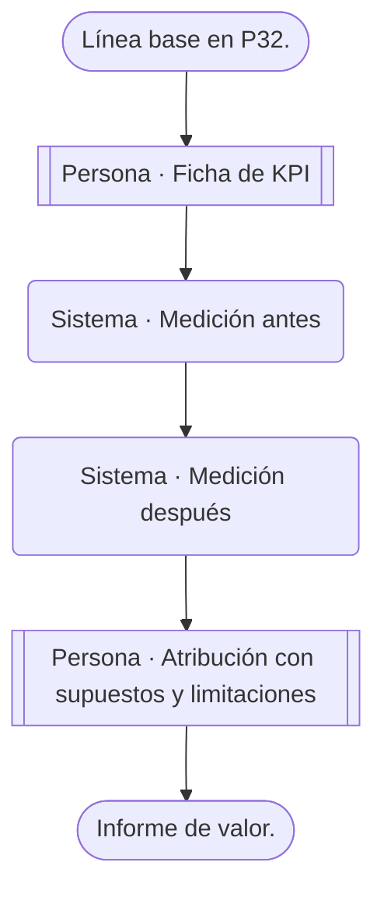

<!-- Generado por tools/org_gen.py desde tools/org_data/. No editar a mano. -->
# P37 · Medición de rendimiento y valor

**Origen:** Atlas Evolución v1.1 §10 (propuesta) · **Cuándo implantar:** MVP · **Estado de la ficha:** draft · **Implementado:** No

Leyenda: rectángulo, regla en código · paralelogramo, la IA propone · doble barra, persona · redondeado, sistema.

## 1. Descripción y objetivo
Línea base, KPI, ROI, calidad, costes, adopción y atribución.

## 2. Evento de inicio
Línea base en [P32](P32-descubrimiento-de-procesos.md).

## 3. Condiciones y datos de entrada
Fuentes de datos trazables.

## 4. Actividades y tareas
1. Ficha de KPI (Persona)
2. Medición antes (Sistema)
3. Medición después (Sistema)
4. Atribución con supuestos y limitaciones (Persona)

## 5. Responsables
Métricas

## 6. Departamentos y especialistas
- [Especialista en métricas](../../knowledge/procesos/metricas.md)

## 7. Decisiones y reglas
- No atribuir mejoras sin evidencia suficiente.

## 8. Estados y transiciones
KPI: definido → medido → revisado

## 9. Entradas y salidas de cada tarea
| Tarea | Tipo | Salida |
|---|---|---|
| Ficha de KPI | Persona | Ficha |
| Medición antes | Sistema | Baseline |
| Medición después | Sistema | Resultado |
| Atribución con supuestos y limitaciones | Persona | Informe de valor |

## 10. Sistemas y conectores
Motor de procesos y PostgreSQL (por defecto).

## 11. Permisos y controles
Mínimos para la tarea; cliente derivado de la identidad.

## 12. Excepciones y rutas alternativas
Errores según P22; incidentes según P28.

## 13. Aprobaciones humanas
Según la matriz de riesgo (docs/14).

## 14. Timeouts y reintentos
Timeout por tarea; máximo 3 intentos con espera exponencial y aleatoria solo para errores transitorios ([P22](P22-gestion-de-errores-y-reintentos.md))

## 15. Criterio de finalización
Informe de valor.

## 16. Evidencias que se conservan
- KPIObservation

## 17. KPI
- KPI con ficha completa

## 18. Dependencias
- [P18](P18-evaluacion-y-mejora.md)
- [P32](P32-descubrimiento-de-procesos.md)

## 19. Precedentes y plantillas
- knowledge/plantillas/ficha-kpi.md

## 20. Pruebas necesarias
- Informe reproducible.

---
Especialistas: Especialista en métricas. Definición original: Atlas Evolución v1.1 §10 (propuesta).
