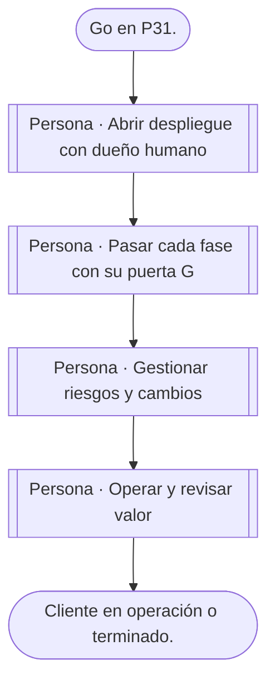

<!-- Generado por tools/org_gen.py desde tools/org_data/. No editar a mano. -->
# P38 · Gestión de despliegue por cliente

**Origen:** Atlas Evolución v1.1 §10 (propuesta) · **Cuándo implantar:** Antes de datos reales · **Estado de la ficha:** draft · **Implementado:** No

Leyenda: rectángulo, regla en código · paralelogramo, la IA propone · doble barra, persona · redondeado, sistema.

## 1. Descripción y objetivo
Fases D0–D6, puertas, riesgos, aceptación, soporte y mejora.

## 2. Evento de inicio
Go en [P31](P31-calificacion-de-oportunidad.md).

## 3. Condiciones y datos de entrada
Ficha de oportunidad.

## 4. Actividades y tareas
1. Abrir despliegue con dueño humano (Persona)
2. Pasar cada fase con su puerta G (Persona)
3. Gestionar riesgos y cambios (Persona)
4. Operar y revisar valor (Persona)

## 5. Responsables
Responsable de implantación

## 6. Departamentos y especialistas
- [Responsable de implantación de clientes](../../knowledge/procesos/implantacion-clientes.md)
- [Especialista en éxito de cliente](../../knowledge/comercial/gestion-clientes.md)

## 7. Decisiones y reglas
- Una puerta no se supera por calendario.

## 8. Estados y transiciones
Despliegue: qualified → discovery → design → prototype → pilot → production → operating → paused / terminated

## 9. Entradas y salidas de cada tarea
| Tarea | Tipo | Salida |
|---|---|---|
| Abrir despliegue con dueño humano | Persona | Deployment |
| Pasar cada fase con su puerta G | Persona | Puerta superada |
| Gestionar riesgos y cambios | Persona | Registro |
| Operar y revisar valor | Persona | D6 |

## 10. Sistemas y conectores
Motor de procesos y PostgreSQL (por defecto).

## 11. Permisos y controles
Mínimos para la tarea; cliente derivado de la identidad.

## 12. Excepciones y rutas alternativas
Errores según P22; incidentes según P28.

## 13. Aprobaciones humanas
- Cliente y socio en cada puerta

## 14. Timeouts y reintentos
Timeout por tarea; máximo 3 intentos con espera exponencial y aleatoria solo para errores transitorios ([P22](P22-gestion-de-errores-y-reintentos.md))

## 15. Criterio de finalización
Cliente en operación o terminado.

## 16. Evidencias que se conservan
- Actas de puerta

## 17. KPI
- Puertas a la primera

## 18. Dependencias
- [P31](P31-calificacion-de-oportunidad.md)
- [P32](P32-descubrimiento-de-procesos.md)
- [P33](P33-diseno-y-validacion-to-be.md)
- [P37](P37-medicion-de-rendimiento-y-valor.md)

## 19. Precedentes y plantillas
Ninguna todavía.

## 20. Pruebas necesarias
- Despliegue no pasa a pilot sin G3.

---
Especialistas: Responsable de implantación de clientes, Especialista en éxito de cliente. Definición original: Atlas Evolución v1.1 §10 (propuesta).
