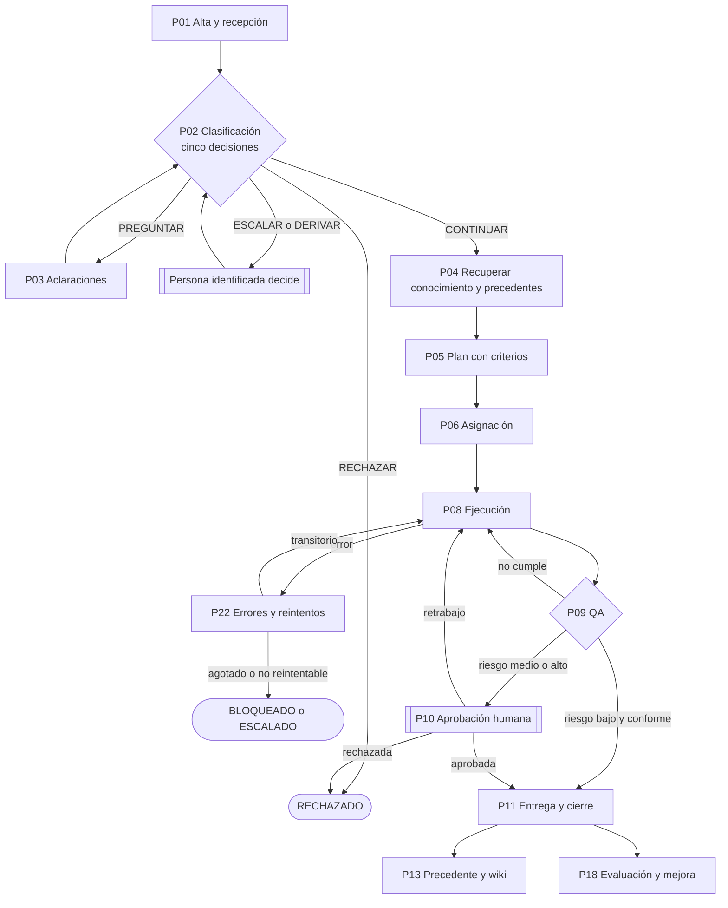

# Ciclo completo de un encargo (P01 → P11)

Así se encadenan los procesos. Los estados son los de la Guía v1.4 §4. Las transiciones que la Guía no define están marcadas como *añadidas* en [`definitions/encargo.json`](../definitions/encargo.json).

Controles transversales en todo el ciclo:
- **P14:** aislamiento.
- **P15:** observabilidad.
- **P19:** política.
- **P20:** entradas no confiables.
- **P21:** herramientas.
- **P29:** costes.
