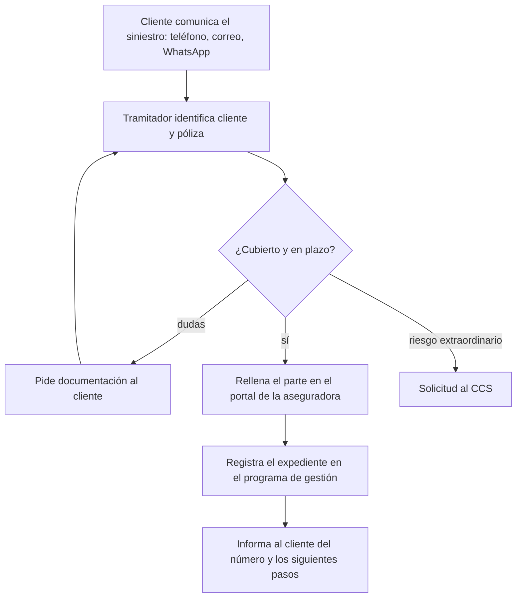

# Seguros · Apertura de siniestros en corredurías (proceso de referencia)

**Estado:** draft. **Todo lo de este documento son hipótesis**, salvo lo que tiene fuente. Se valida en las conversaciones semanales (D-011). Datos: solo inventados. La decisión sobre el proceso de referencia está pendiente (vence el 22/11/2026).

## Lo que sabemos con fuente
- El tomador comunica el siniestro en un máximo de 7 días desde que lo conoce, salvo plazo mayor en la póliza ([LCS art. 16](../../knowledge/fuentes/registro.md#lcs-50-1980)).
- Los riesgos extraordinarios los gestiona el Consorcio de Compensación de Seguros. La solicitud puede presentarla el mediador, y en la práctica suele llegar a través de agentes y corredores ([CCS](../../knowledge/fuentes/registro.md#ccs)).
- En daños materiales entre dos vehículos existen convenios entre aseguradoras ([CIDE-CICOS](../../knowledge/fuentes/registro.md#cide-cicos), draft).
- Los corredores tienen obligaciones de libros-registro e información ([RD 287/2021](../../knowledge/fuentes/registro.md#rd-287-2021)).

## AS-IS hipotético (por validar)

## Preguntas para la validación
1. ¿Por qué canales llegan los siniestros y en qué proporción?
2. ¿Cuántos se abren al mes y cuánto tiempo lleva abrir uno: trabajo activo y espera?
3. ¿Qué datos faltan con más frecuencia?
4. ¿Cuántos portales de aseguradoras usáis y cómo se entra en cada uno?
5. ¿Qué errores obligan a rehacer un parte?
6. ¿Qué excepciones son frecuentes (extraordinarios, daños personales, fraude sospechado)?
7. ¿Quién decide qué y qué no debería decidir nunca una máquina?
8. ¿Cuánto cuesta hoy, en horas, un siniestro mal abierto?

## TO-BE candidato (no diseñar en firme hasta validar el AS-IS)
| Paso | Regla | IA propone | Persona |
|---|---|---|---|
| Recepción multicanal | Registro, identificación por póliza | Extraer datos del mensaje | — |
| Comprobación de plazo y póliza | Plazo de 7 días, póliza vigente (datos inventados) | — | Excepciones |
| Petición de documentación | Lista por tipo de siniestro | Redactar la petición | Aprobar envío (acción externa) |
| Parte en el portal de la aseguradora | — | Prellenar | Enviar (acción externa) |
| Riesgo extraordinario | Detectar por tipo de causa | — | Decidir la vía CCS |

La cobertura y la indemnización no las decide la IA (Atlas §5).

## Métrica de éxito candidata
Tiempo desde la comunicación hasta el parte registrado, con la línea base de las entrevistas. El umbral del examen está pendiente de decidir (22/01/2027).
