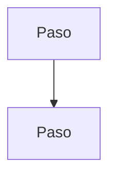

# <sector> · <proceso>

**Estado:** draft · **Despliegue:** D1 Discovery · **Dueño en Varios:** · **Dueño en el cliente:** · **Datos:** inventados hasta L2

## 1. Ficha
- Objetivo de negocio:
- Sponsor:
- Usuarios que ejecutan el proceso:
- Sistemas implicados:

## 2. AS-IS (validado con quien lo ejecuta)

| Paso | Quién | Sistema | Tiempo | Errores frecuentes |
|---|---|---|---|---|

### Variantes

### Excepciones
| Excepción | Frecuencia | Qué se hace hoy |
|---|---|---|

### Línea base (ficha KPI por métrica)
- Volumen al mes:
- Tiempo por caso (trabajo activo y espera):
- Errores y retrabajo:
- Coste:

## 3. TO-BE
| Paso | Regla (código) | IA propone | Persona decide |
|---|---|---|---|

## 4. Riesgo
- Nivel por tarea:
- Datos personales y categorías especiales:
- Clasificación orientativa según el Reglamento de IA (no es asesoría jurídica):

## 5. Métrica de éxito firmada
- Situación de partida, objetivo, cómo se mide y quién la certifica:

## 6. Aprobaciones humanas por tipo de acción

## 7. Integraciones necesarias (catálogo)

## 8. Validación
- G1 (AS-IS): quién y cuándo
- G2 (TO-BE): quién y cuándo
